# Identity Compromise and Privilege Escalation Detection with Microsoft Sentinel

Blue Team lab for detecting suspicious authentication activity followed by local privilege escalation using Microsoft Sentinel.

The project correlates failed and successful Windows logons with local Administrators group membership changes. The final detection uses Windows account SIDs to verify that the account that successfully authenticated is the same account later added to the Administrators group.

## Results

| Area | Result |
|---|---|
| Authentication telemetry | Failed and successful logons collected through Windows Security Events |
| Privilege telemetry | Local Administrators membership changes detected with Event ID `4732` |
| Correlation | Successful-logon SID matched against the SID added to Administrators |
| Sequence validation | `4625 → 4624 → 4732` order enforced in KQL |
| Detection | Generic query works without hardcoding the lab username |
| Analytics | Microsoft Sentinel scheduled rule generated incidents |
| MITRE ATT&CK | Authentication and privilege-escalation behavior mapped to ATT&CK |
| Entity mapping | Host entity added to Sentinel incidents |
| Automation | Severity, tagging, and analyst investigation task applied automatically |
| Final classification | Benign Positive — authorized lab simulation |

## Detection flow

```text
Repeated Failed Logons
        |
        v
Event ID 4625
        |
        v
Successful Logon
        |
        v
Event ID 4624
        |
        v
Extract authenticated account SID
        |
        v
Local Administrators Group Change
        |
        v
Event ID 4732
        |
        v
Compare TargetUserSid with MemberSid
        |
        v
Validate event order
        |
        v
Microsoft Sentinel Incident
```

## Environment

- Microsoft Azure
- Windows Server 2025
- Microsoft Sentinel
- Log Analytics Workspace
- Azure Monitor Agent
- Windows Security Events via AMA
- Data Collection Rule
- Kusto Query Language

Monitored endpoint:

`win-blue-team-lab`

A dedicated local account, `soclab-user`, was used only to generate controlled test activity. The final detection query is not hardcoded to that username.

## Relevant Windows Security Events

| Event ID | Description | Use |
|---|---|---|
| `4625` | An account failed to log on | Detect repeated authentication failures |
| `4624` | An account was successfully logged on | Identify successful authentication and account SID |
| `4720` | A user account was created | Investigation context |
| `4732` | A member was added to a security-enabled local group | Detect local Administrators membership change |
| `4672` | Special privileges assigned to new logon | Additional investigation context |

Event ID `4720` was intentionally kept as investigation context instead of a required detection condition. Requiring account creation in the same window would make the rule dependent on when the account was originally created.

## Audit policy validation

The Windows audit configuration was checked before generating test activity.

The endpoint recorded:

- successful and failed logons;
- account-management events;
- security group management;
- special logons.

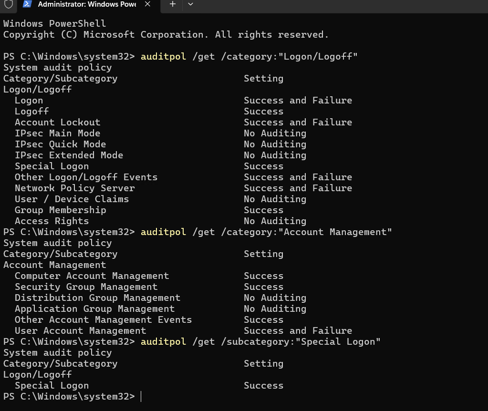

## Controlled test activity

A dedicated local test account was created:

`soclab-user`

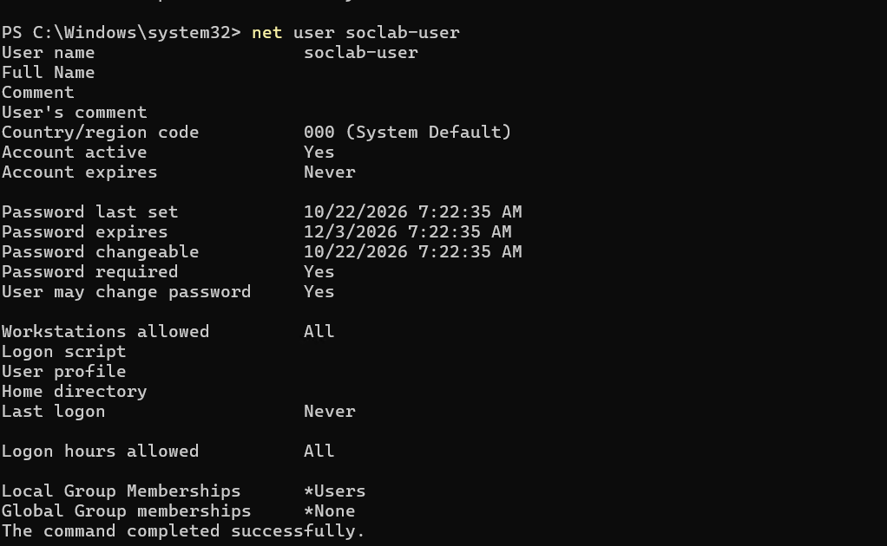

Several failed authentication attempts were generated, followed by a successful authentication.

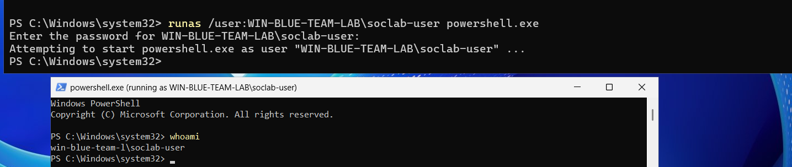

The events were ingested into Microsoft Sentinel.

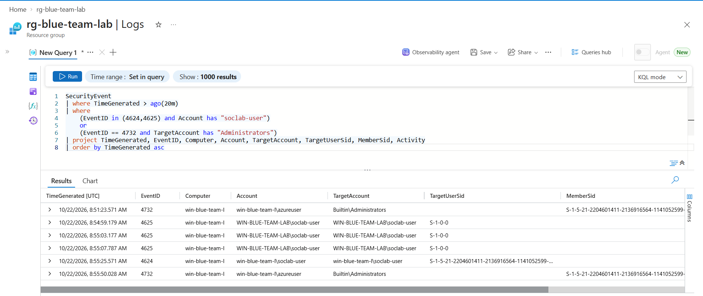

## Account creation context

Event ID `4720` confirmed creation of the test account.

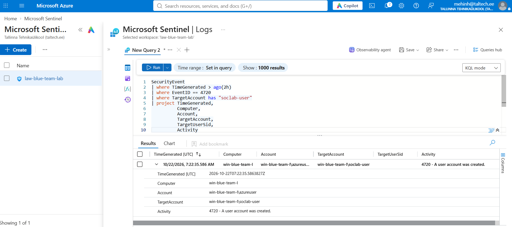

This event was useful during investigation but was not required by the final detection.

## Privilege escalation simulation

The test account was added to the local Administrators group.

Windows generated Event ID:

`4732 — A member was added to a security-enabled local group`

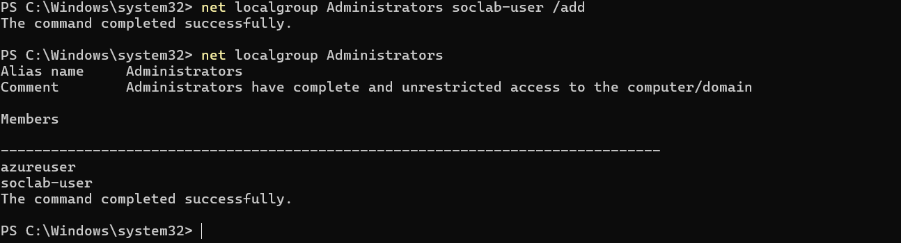

The event exposed the SID of the account added to the group.

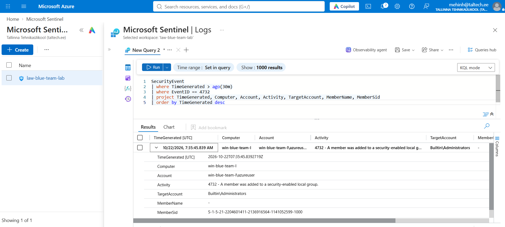

The account SID was independently validated.

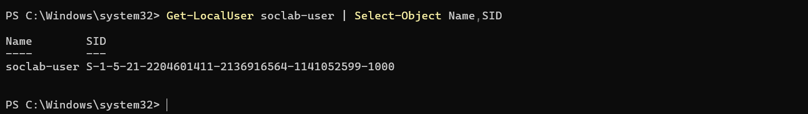

## Attack timeline

The lab produced the following sequence:

```text
Multiple 4625 failed logons
        |
        v
4624 successful logon
        |
        v
4732 Administrators membership change
```

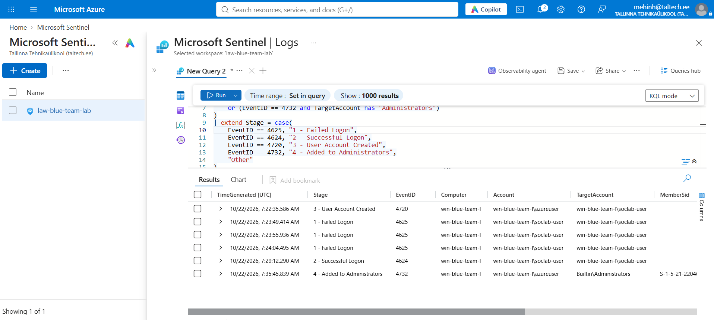

KQL was used to validate the chronological relationship between these events.

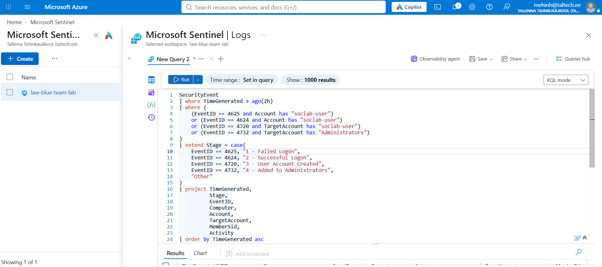

## SID correlation

The strongest part of the detection is account-level SID correlation.

A successful `4624` event exposes:

`TargetUserSid`

A `4732` group-membership event exposes:

`MemberSid`

The detection requires these values to match.

This prevents the rule from correlating a successful logon from one account with an Administrators-group change affecting a different account.

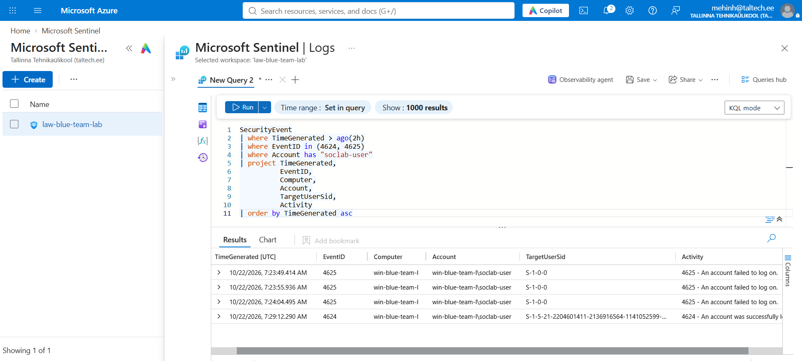

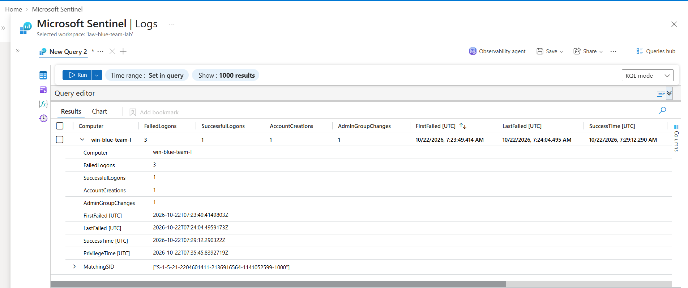

## Detection logic

The final detection:

1. collects `4624` and `4625` authentication events;
2. groups authentication activity by host and username;
3. requires at least three failed logons;
4. requires at least one successful logon;
5. verifies that the failures occurred before the success;
6. identifies Event ID `4732` changes to the Administrators group;
7. compares the successful-logon SID with the SID added to the group;
8. verifies that the privilege change happened after the successful logon.

The detection is no longer tied to `soclab-user`.

The complete KQL is stored in:

[`queries/identity-privilege-escalation.kql`](queries/identity-privilege-escalation.kql)

## Microsoft Sentinel analytics rule

The final query was converted into a scheduled analytics rule.

The rule generated an incident only when the correlated sequence matched.

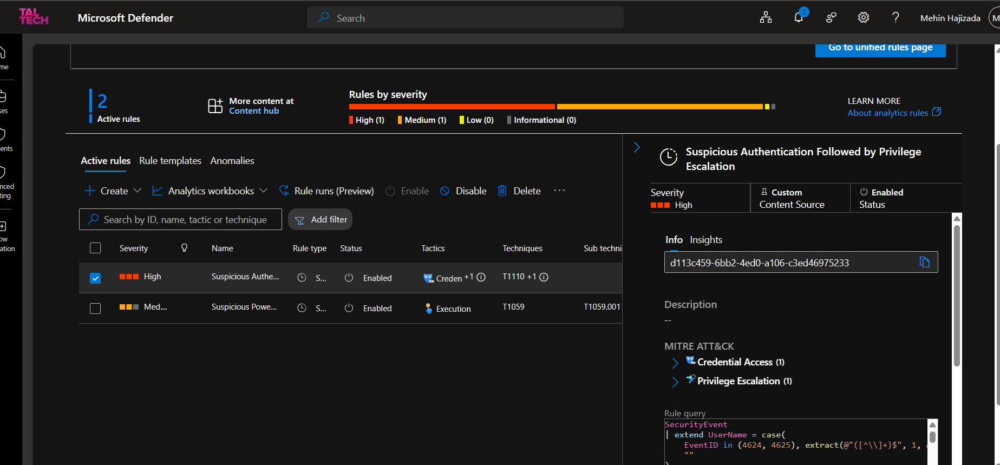

Rule scheduling and incident settings were configured in Microsoft Sentinel.

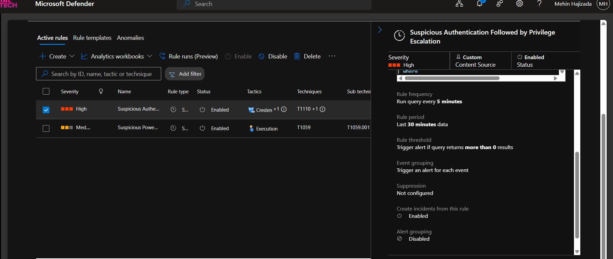

## Entity mapping

The affected Windows host was mapped into the Sentinel incident.

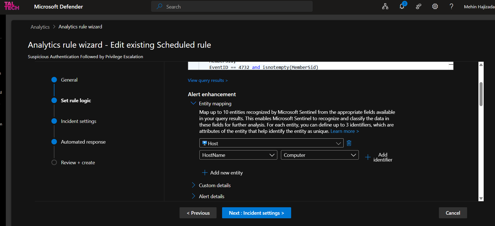

This allowed the endpoint involved in the correlated authentication and privilege activity to appear directly in the investigation.

## Automated incident triage

A Sentinel automation rule was configured to apply initial SOC triage actions.

Automation included:

- incident severity handling;
- tagging;
- creation of an analyst investigation task.

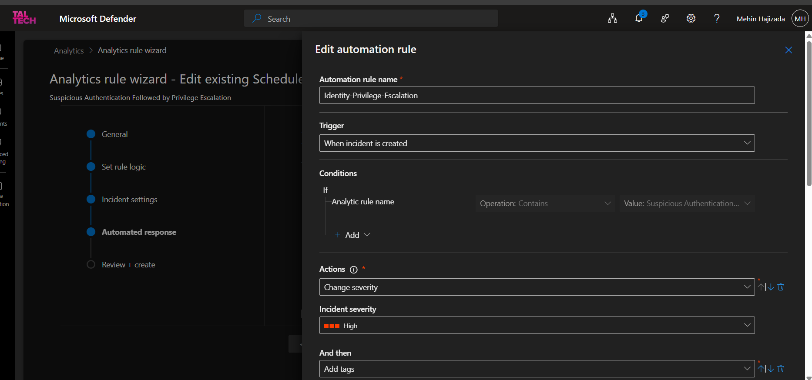

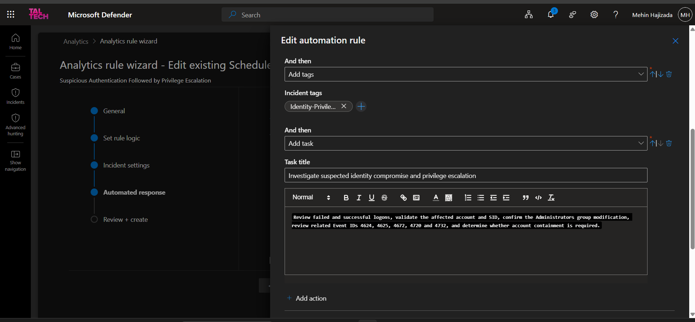

The final incident included the automated triage actions.

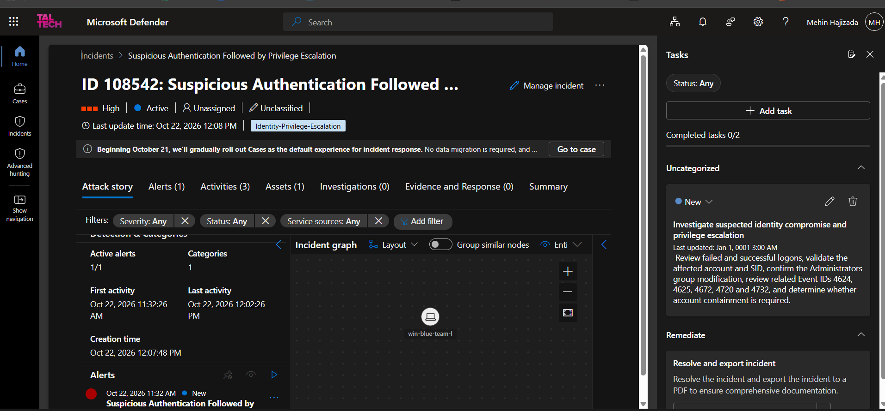

Multiple generated incidents were also visible in the Sentinel incident queue.

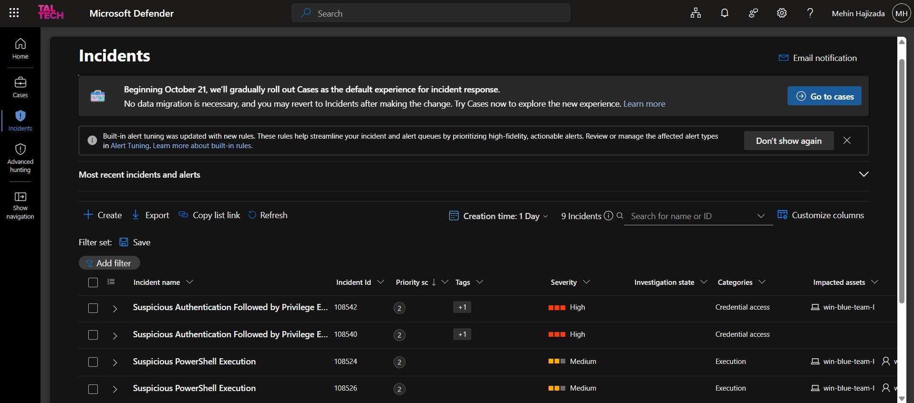

## Detection tuning

The original lab query was explicitly filtered to:

`soclab-user`

That worked for controlled validation but was not suitable as a reusable detection.

The final query removed the username hardcode and instead relies on:

- authentication activity grouped by username;
- event sequencing;
- account SID correlation;
- local Administrators group membership change.

This makes the detection reusable across accounts while preserving the relationship between the successful authentication and privilege change.

## Detection limitations

The detection remains a lab-oriented behavioral rule.

Potential false positives include:

- users mistyping passwords before a successful login;
- legitimate helpdesk password recovery;
- approved local administrator assignment;
- software deployment or endpoint-management activity;
- administrator account maintenance.

The query also correlates activity on the same host. Production deployments could improve precision with additional context such as:

- logon type;
- source IP address;
- workstation name;
- administrative account baselines;
- approved group-management workflows;
- process creation telemetry;
- identity-risk signals;
- Microsoft Defender for Endpoint telemetry;
- Entra ID sign-in context.

The threshold of three failed logons is a lab tuning choice and should not be treated as a universal production threshold.

## What changed after testing

| Finding | Change |
|---|---|
| Initial query was tied to `soclab-user` | Removed username hardcode |
| Host-level correlation alone was too weak | Added account SID correlation |
| Authentication and privilege events could occur independently | Enforced chronological sequence |
| Account creation did not always belong in the same detection window | Kept Event ID `4720` as investigation context |
| Incidents needed endpoint context | Added Host entity mapping |
| Analysts needed repeatable first steps | Added automated investigation task |
| Large KQL blocks reduced README readability | Kept final query in a dedicated `.kql` file |

## Repository structure

```text
sentinel-identity-privilege-escalation/
├── README.md
├── incident-report.md
├── queries/
│   └── identity-privilege-escalation.kql
└── screenshots/
    ├── 01-audit-policy-validation.png
    ├── 02-test-user-created.png
    ├── 03-successful-test-user-logon.png
    ├── 04-identity-logon-events.png
    ├── 05-user-account-created-event.png
    ├── 06-user-added-to-administrators.png
    ├── 07-administrator-membership-sid.png
    ├── 08-user-sid-validation.png
    ├── 09-identity-attack-timeline.png
    ├── 10-identity-timeline-kql-query.png
    ├── 11-logon-account-sid-validation.png
    ├── 13-sid-correlated-identity-detection.png
    ├── 14-automation-rule-severity-and-tag.png
    ├── 15-automation-rule-investigation-task.png
    ├── 16-host-entity-mapping.png
    ├── 17-final-analytics-rule-overview.png
    ├── 18-final-rule-scheduling-and-incidents.png
    ├── 20-final-identity-incident-with-automation.png
    └── 21-final-incidents-overview.png
```

## Scope

This project was built in a controlled Azure lab using intentionally generated authentication and privilege-management activity.

The final incident was classified as a Benign Positive because the behavior was authorized security testing.

The project demonstrates detection engineering and SOC investigation workflow. The detection should be tuned further before production use.
