# Identity Compromise and Privilege Escalation Detection with Microsoft Sentinel

## Overview

This project demonstrates an end-to-end Blue Team investigation and detection workflow for suspicious authentication activity followed by privilege escalation.

The lab was built in Microsoft Azure using a Windows Server endpoint and Microsoft Sentinel. A controlled identity-based attack sequence was generated, investigated through Windows Security Events, correlated using KQL, converted into a scheduled analytics rule, and validated through a real Sentinel incident.

The final detection goes beyond host-level correlation. It verifies that the SID associated with the successful authentication is the same SID later added to the local Administrators group.

Automated incident triage was also configured to apply severity, tagging, Host entity mapping, and an investigation task when the detection generated an incident.

---

## Project Objectives

The main goals were to:

- collect Windows authentication and account-management telemetry;
- simulate repeated failed authentication attempts;
- identify a subsequent successful authentication;
- detect addition of the authenticated account to the local Administrators group;
- correlate authentication and privilege events using the Windows account SID;
- validate the chronological order of the activity in KQL;
- create a Microsoft Sentinel scheduled analytics rule;
- map the behavior to MITRE ATT&CK;
- automatically generate a high-severity incident;
- enrich the incident with a Host entity;
- automate initial SOC triage actions;
- document investigation and remediation steps.

---

## Lab Environment

The project used:

- Microsoft Azure
- Windows Server 2025
- Microsoft Sentinel
- Log Analytics Workspace
- Azure Monitor Agent
- Windows Security Events via AMA
- Data Collection Rule
- Kusto Query Language (KQL)
- Microsoft Defender incident interface

Monitored endpoint:

`win-blue-team-lab`

Dedicated local test account:

`soclab-user`

---

## Relevant Windows Security Events

| Event ID | Description | Use in Project |
| --- | --- | --- |
| `4625` | An account failed to log on | Detect repeated authentication failures |
| `4624` | An account was successfully logged on | Identify successful authentication and obtain the account SID |
| `4720` | A user account was created | Investigation context for the test account |
| `4732` | A member was added to a security-enabled local group | Detect addition to the local Administrators group |
| `4672` | Special privileges assigned to new logon | Additional investigation context |

Event `4720` was reviewed during the investigation but was intentionally not made a mandatory condition in the final analytics rule. Requiring account creation within the same detection window would make the detection unnecessarily dependent on when the account was created.

---

## Audit Policy Validation

Before generating test activity, the relevant Windows audit policies were verified.

The system was configured to record:

- successful and failed logons;
- account lockout activity;
- special logons;
- user account management;
- security group management.

This ensured that the required authentication and privilege-management telemetry was available in Microsoft Sentinel.

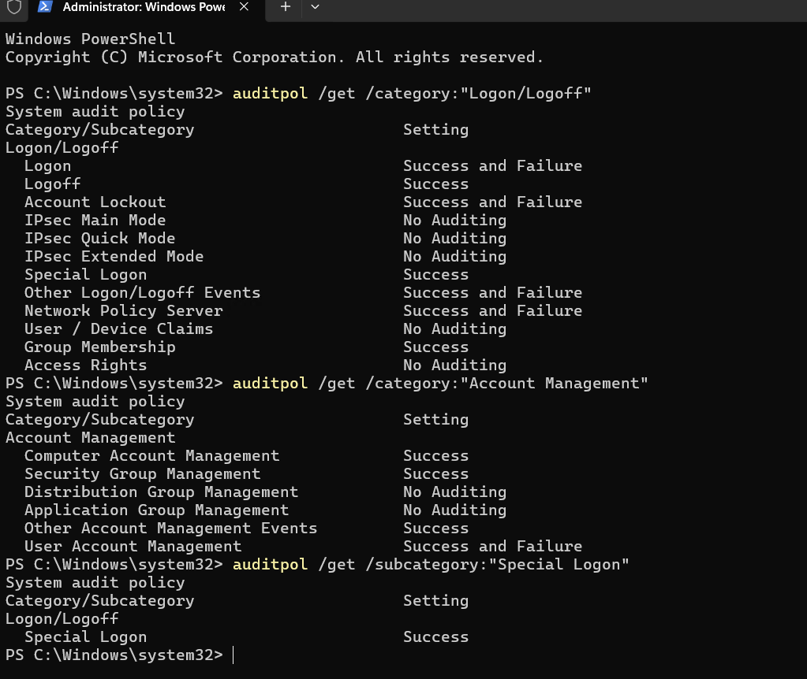

---

## Test Account Creation

A dedicated local account named `soclab-user` was created for the controlled simulation.

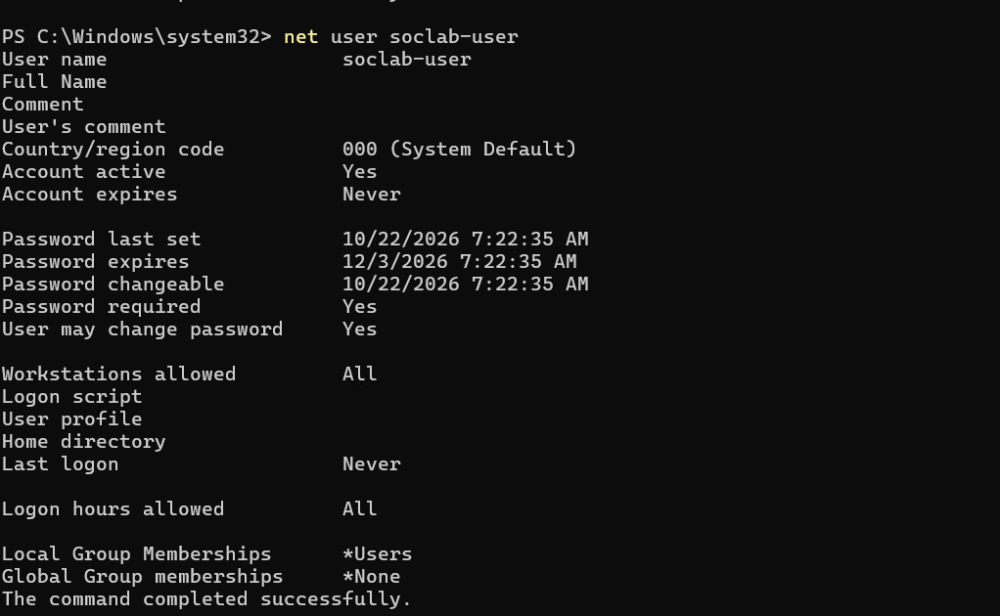

The account initially belonged only to the standard local Users group and had not yet been used for authentication.

---

## Controlled Authentication Activity

Several failed authentication attempts were intentionally generated for `soclab-user`.

They were followed by a successful authentication using the same account.

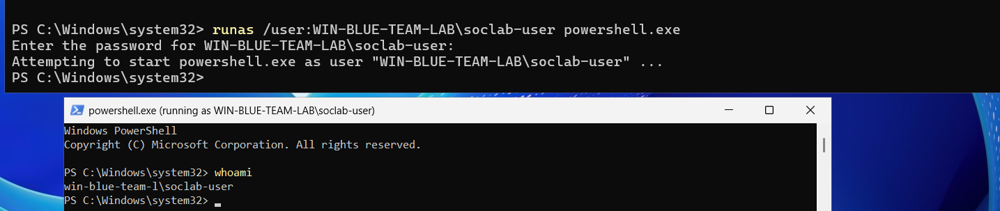

Microsoft Sentinel recorded the authentication activity through Windows Security Events.

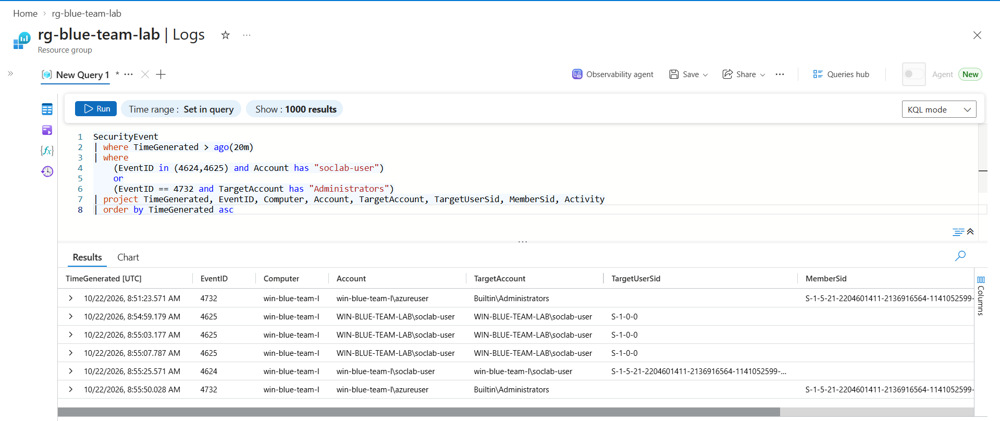

The investigation showed multiple `4625` failed logons followed by a `4624` successful logon for the test account.

---

## Account Creation Evidence

The account creation was also visible in Microsoft Sentinel as Event ID `4720`.

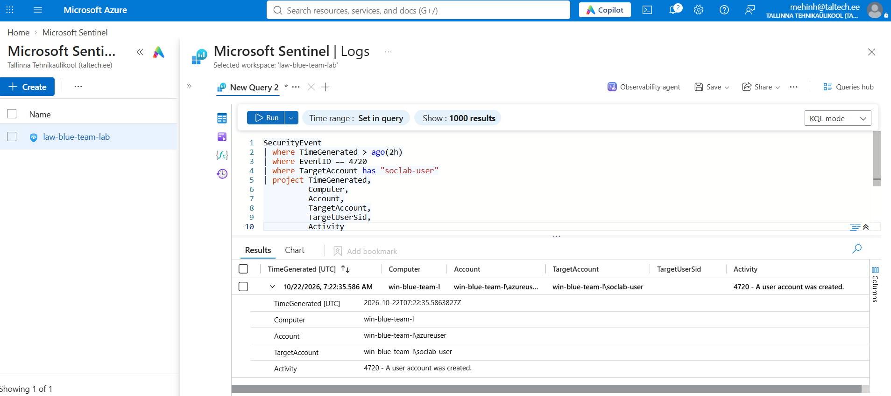

This event was useful during the investigation, although it was later removed as a mandatory requirement from the final production-style detection logic.

---

## Privilege Escalation Simulation

The test account was added to the local `Administrators` group:

```powershell
net localgroup Administrators soclab-user /add
```

The new membership was validated on the endpoint.

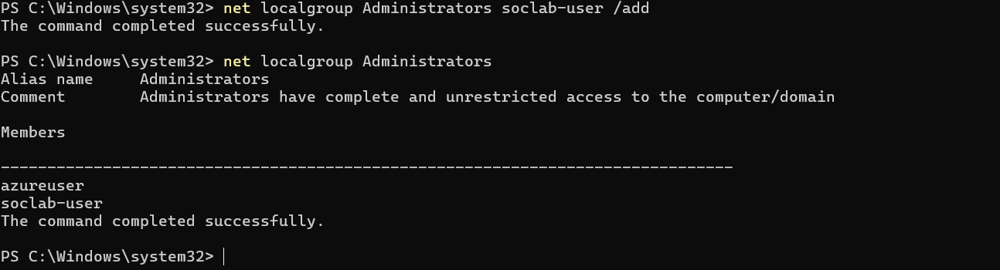

Windows generated Event ID `4732`, recording the privileged group membership change.

The event contained the SID of the account added to the group.

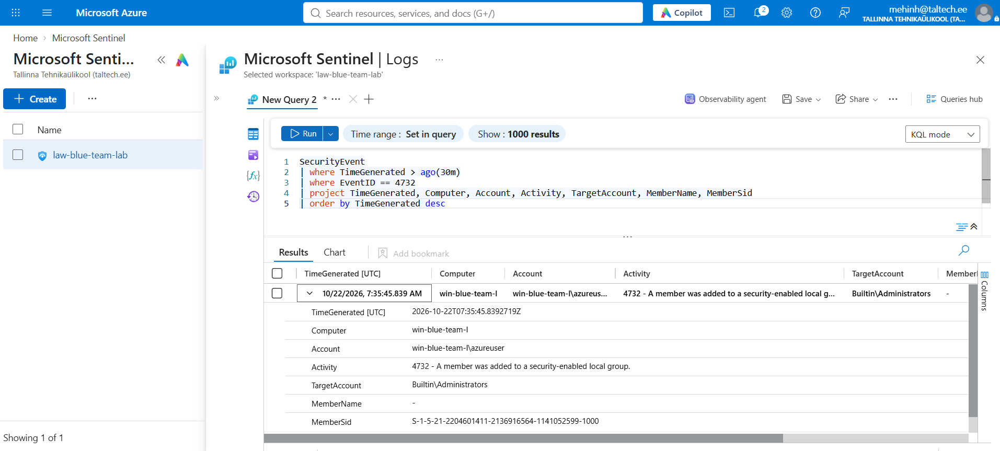

The SID of `soclab-user` was independently validated on the endpoint.

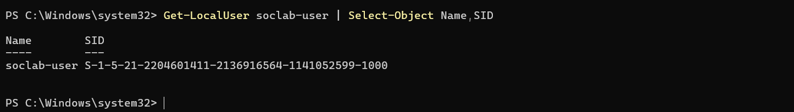

---

## Initial Investigation Timeline

The first investigation query organized the relevant events into a chronological timeline.

The observed sequence was:

```text
Failed Logon
Failed Logon
Failed Logon
Successful Logon
Added to Administrators
```

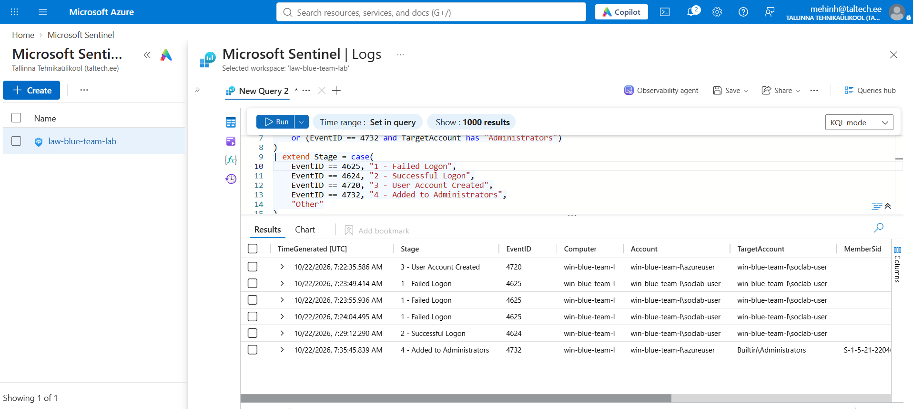

The KQL used to construct the investigation timeline was also documented.

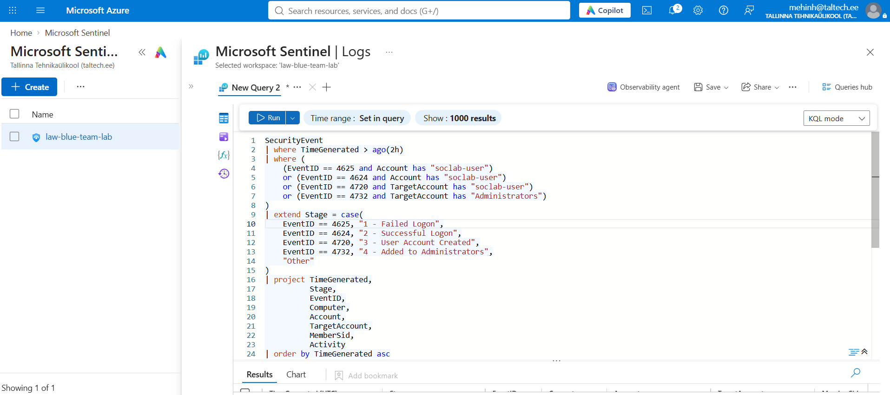

---

## SID Validation

A successful Event ID `4624` contained a valid `TargetUserSid` for `soclab-user`.

Failed authentication attempts may contain an unresolved SID such as `S-1-0-0`, so the successful authentication was used as the reliable identity-to-SID bridge.

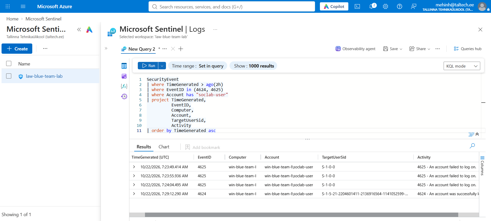

The account creation event was also reviewed as supporting investigation context.

---

## SID-Based Correlation

A major goal of the project was to prove that the account successfully authenticated in Event ID `4624` was the same account later added to the local Administrators group in Event ID `4732`.

The relevant fields were:

```text
4624 -> TargetUserSid
4732 -> MemberSid
```

The detection collects both SID sets and compares them using:

```kql
set_intersect(SuccessfulLogonSIDs, AdminMemberSIDs)
```

The detection proceeds only if:

```kql
array_length(MatchingSID) > 0
```

This prevents the rule from triggering merely because unrelated authentication and group-modification events occurred on the same host.

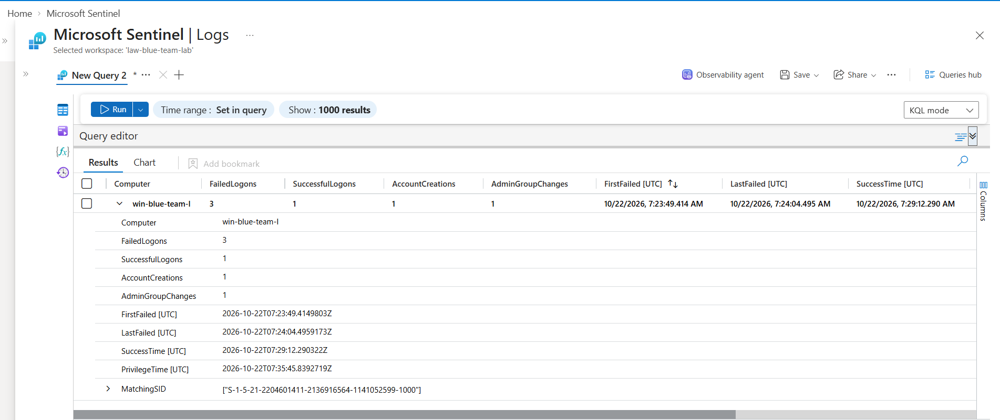

---

## Final Detection Logic

The final detection identifies the following behavior:

```text
3 or more failed logons
          |
          v
Successful logon
          |
          v
Obtain authenticated account SID
          |
          v
Same SID added to local Administrators
          |
          v
High-severity Sentinel incident
```

The rule also validates the chronological sequence:

```text
LastFailed < SuccessTime < PrivilegeTime
```

This prevents an earlier unrelated Administrators-group modification from satisfying the detection.

---

## Final KQL Detection

```kql
SecurityEvent
| extend UserName = case(
    EventID in (4624, 4625), extract(@"([^\\]+)$", 1, Account),
    ""
)
| where
    (EventID == 4625 and UserName == "soclab-user")
    or (EventID == 4624 and UserName == "soclab-user")
    or (EventID == 4732 and TargetAccount has "Administrators")
| summarize
    FailedLogons = countif(EventID == 4625),
    SuccessfulLogons = countif(EventID == 4624),
    AdminGroupChanges = countif(EventID == 4732),
    FirstFailed = minif(TimeGenerated, EventID == 4625),
    LastFailed = maxif(TimeGenerated, EventID == 4625),
    SuccessTime = maxif(TimeGenerated, EventID == 4624),
    PrivilegeTime = maxif(TimeGenerated, EventID == 4732),
    SuccessfulLogonSIDs = make_set_if(
        TargetUserSid,
        EventID == 4624
            and isnotempty(TargetUserSid)
            and TargetUserSid != "S-1-0-0"
    ),
    AdminMemberSIDs = make_set_if(
        MemberSid,
        EventID == 4732
            and isnotempty(MemberSid)
    )
    by Computer
| extend MatchingSID = set_intersect(
    SuccessfulLogonSIDs,
    AdminMemberSIDs
)
| where FailedLogons >= 3
| where SuccessfulLogons >= 1
| where AdminGroupChanges >= 1
| where array_length(MatchingSID) > 0
| where LastFailed < SuccessTime
| where SuccessTime < PrivilegeTime
| project
    Computer,
    FailedLogons,
    SuccessfulLogons,
    AdminGroupChanges,
    FirstFailed,
    LastFailed,
    SuccessTime,
    PrivilegeTime,
    MatchingSID
```

The same query is stored separately in:

```text
queries/identity-privilege-escalation.kql
```

---

## Microsoft Sentinel Analytics Rule

### Rule Name

`Suspicious Authentication Followed by Privilege Escalation`

### Severity

`High`

### Scheduling

- Query frequency: 5 minutes
- Lookup period: 30 minutes
- Alert threshold: greater than 0 results
- Incident creation: enabled
- Alert grouping: disabled
- Suppression: disabled

### Entity Mapping

The following Host entity mapping was configured:

```text
Entity type: Host
Identifier: HostName
Value: Computer
```

This allowed the affected endpoint to appear directly in the Sentinel incident graph.

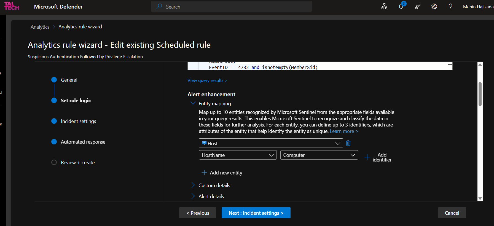

### Final Rule

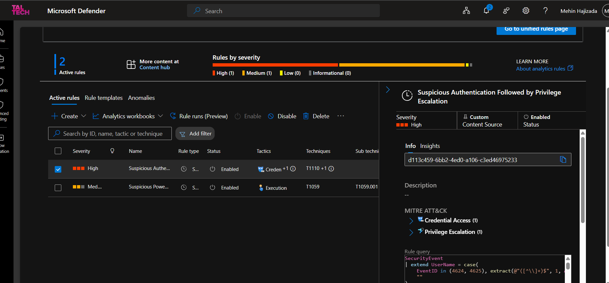

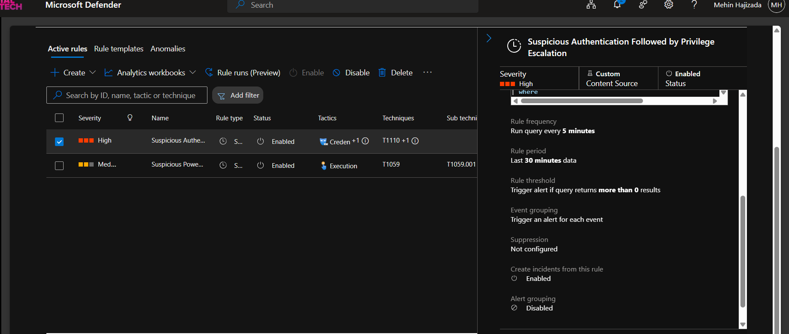

---

## MITRE ATT&CK Mapping

The detection was mapped to the following behaviors.

### Credential Access

**T1110.001 — Brute Force: Password Guessing**

The controlled sequence included repeated incorrect password attempts followed by successful authentication.

### Privilege Escalation

**T1098.007 — Account Manipulation: Additional Local or Domain Groups**

The authenticated account was subsequently added to the local Windows `Administrators` group, granting elevated privileges.

---

## Automated Incident Response

A Microsoft Sentinel automation rule was configured for incidents generated by the analytics rule.

### Automation Rule

`Identity-Privilege-Escalation`

### Trigger

`When incident is created`

### Automated Actions

The automation rule:

- sets incident severity to `High`;
- adds the tag `Identity-Privilege-Escalation`;
- creates an investigation task for the analyst.

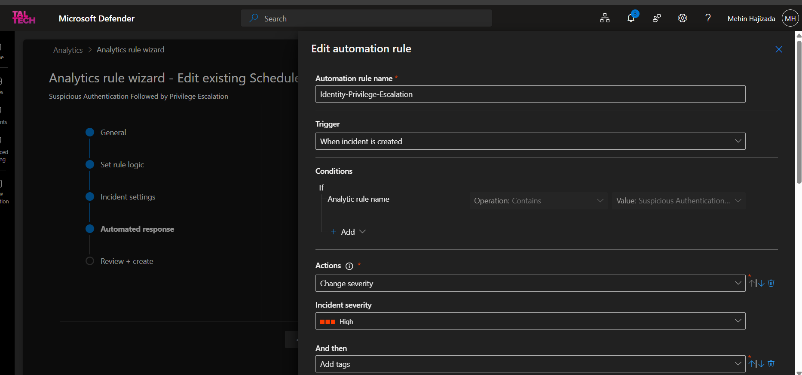

### Automated Investigation Task

Task title:

`Investigate suspected identity compromise and privilege escalation`

Task instructions:

> Review failed and successful logons, validate the affected account and SID, confirm the Administrators group modification, review related Event IDs 4624, 4625, 4672, 4720 and 4732, and determine whether account containment is required.

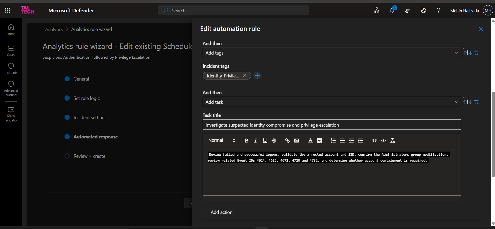

Destructive response actions such as automatically disabling the account were intentionally not implemented.

Account containment should occur only after an analyst confirms that the activity is malicious.

---

## Final Validation

After the final KQL, entity mapping, and automation configuration were completed, a fresh attack sequence was generated.

The new events confirmed:

- multiple failed logons;
- a successful logon;
- subsequent Administrators-group modification;
- SID correlation between authentication and privilege-change activity.

Microsoft Sentinel successfully generated the high-severity incident:

`Suspicious Authentication Followed by Privilege Escalation`

The incident contained:

- High severity;
- `Identity-Privilege-Escalation` tag;
- active alert;
- mapped Host entity `win-blue-team-lab`;
- automatically created investigation task;
- affected endpoint displayed in the incident graph.

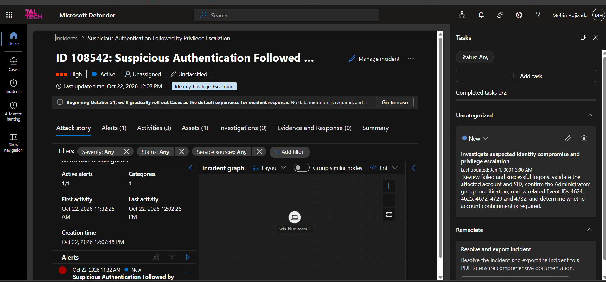

The final incident list also confirmed the new High-severity detection and impacted asset.

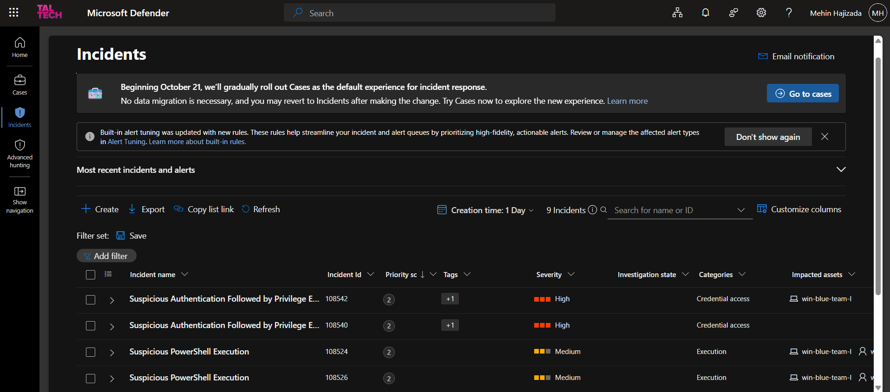

---

## Detection Pipeline

```text
Windows Authentication Events
            |
            v
Microsoft Sentinel
            |
            v
KQL Correlation
            |
            v
SID Validation
            |
            v
Scheduled Analytics Rule
            |
            v
High-Severity Alert
            |
            v
Sentinel Incident
            |
            v
Host Entity Mapping
            |
            v
Automated SOC Triage
```

---

## Investigation Approach

An analyst responding to this detection should:

1. Review failed authentication attempts and their timing.
2. Confirm the successful authentication associated with the account.
3. Validate the authenticated account SID.
4. Confirm that the same SID was added to the Administrators group.
5. Identify the account responsible for modifying the group.
6. Review the source and logon type of the successful authentication.
7. Investigate Event ID `4672` for privileged-logon activity.
8. Search the endpoint for suspicious process execution or persistence.
9. Review other systems for authentication activity involving the same account.
10. Determine whether containment is required.

---

## Response and Remediation

If the activity is confirmed to be malicious:

- disable or reset the compromised account;
- remove unauthorized membership from the Administrators group;
- terminate unauthorized sessions;
- investigate the source of the authentication activity;
- review related endpoint activity;
- search for lateral movement;
- review persistence mechanisms;
- rotate affected credentials;
- preserve relevant security logs and evidence;
- investigate whether additional systems were accessed.

The affected endpoint should be isolated if additional evidence indicates active compromise.

---

## Detection Considerations

The final rule improves detection quality through SID and temporal correlation, but a production deployment would require additional tuning.

For example:

- authentication thresholds should reflect the organization's normal behavior;
- service accounts and legitimate automation may generate repeated authentication failures;
- approved administrative activity may legitimately modify local Administrators membership;
- detection should ideally incorporate source IP, workstation, device identity, and additional endpoint telemetry;
- the hardcoded `soclab-user` is appropriate only for this controlled lab and should be replaced with account-based grouping or behavioral logic in production;
- identity-provider and EDR telemetry could provide additional context.

The lab rule intentionally focuses on demonstrating the correlation technique and the complete SOC detection-to-response workflow.

---

## Repository Structure

```text
sentinel-identity-privilege-escalation/
│
├── README.md
├── incident-report.md
│
├── queries/
│   └── identity-privilege-escalation.kql
│
└── screenshots/
    ├── 01-audit-policy-validation.png
    ├── 02-test-user-created.png
    ├── 03-successful-test-user-logon.png
    ├── 04-identity-logon-events.png
    ├── 05-user-account-created-event.png
    ├── 06-user-added-to-administrators.png
    ├── 07-administrator-membership-sid.png
    ├── 08-user-sid-validation.png
    ├── 09-identity-attack-timeline.png
    ├── 10-identity-timeline-kql-query.png
    ├── 11-logon-account-sid-validation.png
    ├── 13-sid-correlated-identity-detection.png
    ├── 14-automation-rule-severity-and-tag.png
    ├── 15-automation-rule-investigation-task.png
    ├── 16-host-entity-mapping.png
    ├── 17-final-analytics-rule-overview.png
    ├── 18-final-rule-scheduling-and-incidents.png
    ├── 20-final-identity-incident-with-automation.png
    └── 21-final-incidents-overview.png
```

---

## Skills Demonstrated

- Microsoft Sentinel
- Kusto Query Language
- Windows Security Event analysis
- Authentication log investigation
- Identity security
- SID analysis
- Threat hunting
- Detection engineering
- Event correlation
- MITRE ATT&CK mapping
- Privilege escalation detection
- Sentinel analytics rules
- Entity mapping
- Incident investigation
- SOC automation
- Incident response planning

---

## Conclusion

This project demonstrates a complete identity-focused Blue Team workflow.

Multiple failed authentication attempts were followed by a successful authentication, after which the authenticated account was added to the local Administrators group.

Rather than correlating the events only by endpoint, the final detection compared the SID from the successful authentication with the SID added to the privileged group and validated the chronological sequence of activity.

The detection was converted into a scheduled Microsoft Sentinel analytics rule, generated a high-severity incident, mapped the affected host, and automatically initiated SOC triage actions.

The result is an end-to-end demonstration of log analysis, identity investigation, detection engineering, incident response, and security automation.
